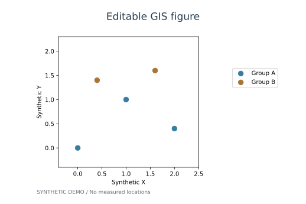

# GIS Plot Editor

面向 GIS 研究制图的可编辑 Matplotlib Skill。由同一个 Agent 完成“首次出图 → 自然语言微调/点选拖拽 → 撤销恢复 → 导出”，默认不重跑空间分析或改写指标值。




图中为合成示例，不代表真实地理数据。运行下方命令可在本地窗口点选、修改属性并拖拽标题、图例与图框。

## 安装

仓库根目录就是完整 Skill（SKILL.md + scripts + references + assets）。在支持 skills CLI 的宿主中（需 Node.js/npm、Git 可用且 Git 在 PATH 中）：

```sh
npx skills add liujiayuGIS/gis-plot-editor --skill gis-plot-editor
```

也可将完整仓库目录添加到宿主的 Skills 目录；不能只安装 SKILL.md。详见 [安装与运行](references/installation.md)。

Python 3.11+ / Tk / Windows 桌面。先探测，再明确安装独立依赖环境：

```sh
python scripts/setup_runtime.py
python scripts/setup_runtime.py --install
```

`--install` 会创建独立 venv，不修改全局 Python、Anaconda 或 PATH。无参数 Windows 应用入口可通过 `--build-app --output-dir <应用目录>` 构建，必要时显式加 `--register-app`；不会自动启动 GUI。应用二进制不随源码仓库分发。

## 功能

- 直接读取 GeoJSON、Shapefile、GeoPackage、GeoTIFF；也能接入已有可信 Python Figure 工厂。
- 持续保留 Figure 与语义 Artist 注册表，微调标题、字体、图例、色标、图框、透明度等。
- 本地 Tk 对象列表、属性编辑与拖拽；Agent 使用白名单 JSON 的文件式命令，无网络服务。
- revision 冲突检测，撤销/重做、关闭恢复、输入哈希检查；系统级会话锁和随状态原子保存的命令回执。
- 源/显示 CRS 分开、缺失/冲突门禁、图层重投影、NoData、分级/图例一致性、局部比例尺/真北预检。
- TIFF/PNG/JPEG/PDF/SVG 固定物理图幅导出与 provenance manifest；DPI、JPEG 质量、TIFF 无损压缩与透明背景选项。
- 点/线/面图例、连续变量缺失值图例、色标截断数量检查，以及按对象 ID 复用的外观模板。

自然语言由调用该 Skill 的 Agent 理解；运行时不带额外 LLM、不需要另一个 Agent 或模型 Key。

## 开始使用

1. Agent 读取 [SKILL.md](SKILL.md)，按请求读取对应 reference。
2. 确认数据、指标/单位、CRS、出图编码与图幅，生成场景 JSON 或已有 Figure 适配器。
3. 使用已验证 Python 执行：

```sh
python scripts/gis_editor.py gui --spec scene.json --session plot-session
```

可信 factory 加 `--trusted-factory`（会执行本地 Python，请先审查代码）。无界面 `render` 不等于可拖拽 GUI。

4. Agent 修改流程为 list → expected_revision → patch → 响应/画面核验，详见 [接口](references/api.md)。

## 示例与测试

`assets/demo.json` 与 `assets/demo_factory.py` 为明确标注的合成示例，不是真实地理研究结果。

```sh
# 已审查的仓库演示 factory，合成数据。
python scripts/gis_editor.py gui --spec assets/demo.json --session demo-session --trusted-factory

# 无界面导出：扩展名也可改成 png / jpg / pdf / svg。
python scripts/gis_editor.py render --spec assets/demo.json --session tiff-session --trusted-factory --output demo.tiff --dpi 600

python -m unittest discover -s scripts -p 'test_*.py' -v
python scripts/gis_editor.py doctor
```

测试覆盖指标不变、撤销/恢复、CRS 门禁、三种矢量格式、栅格 NoData、图例、色标、导出尺寸/DPI/压缩与透明度、异常中断后命令去重和跨进程会话锁。GitHub Actions 在 Windows/macOS/Linux 执行无界面回归；这不替代真实桌面 GUI、超大数据或科学有效性的验证。

## 导出格式

| 格式 | 扩展名 | 选项与用途 |
| --- | --- | --- |
| TIFF | `.tif` / `.tiff` | 默认 LZW 无损压缩；可选 Deflate 或不压缩，支持透明背景 |
| PNG | `.png` | 无损，支持透明背景 |
| JPEG | `.jpg` / `.jpeg` | 默认质量 95，白底，适合分享；不支持透明背景 |
| PDF | `.pdf` | 矢量图形与嵌入字体；栅格图层仍为栅格 |
| SVG | `.svg` | 矢量图形与文字；接收端需安装对应字体 |

GUI 可设置 DPI；命令行可加 `--jpeg-quality 95`、`--tiff-compression tiff_lzw`、`--transparent`。每个成图旁生成 `.manifest.json`，保存物理图幅、DPI、格式、选项、输入哈希和最终尺寸下的检查结果。TIFF 是排版成图，不包含 GeoTIFF 地理配准。

## 多幅论文图统一样式

在编辑器中保存/应用样式模板，或通过 `style_get` / `style_apply` 命令操作。模板复用字体、布局、色带和图幅，保留目标图的标题、单位、数据、投影与地图范围。共享色标上下限必须显式选择，并先核对指标含义和单位；对象 ID 与类型必须匹配。完整接口见 [API](references/api.md)。

通过 `size_mm` 指定图幅，例如 `[85, 65]` 或 `[180, 130]`，以期刊要求为准。中文字体自动探测 Windows/macOS/Linux 常见字体，也可用 `font` 显式指定已安装字体。应用模板可撤销。

## 边界

- PNG 不能恢复原始指标或 Figure 对象，需数据/源码或保存的场景。
- 复杂多面板/插图通过 factory；多个连续主题、分类栅格和跨日界线须显式适配。
- 真北/比例尺等复合元素不支持拆开自由拖拽。
- 数据几何/指标默认锁定；投影、范围、分级语义变更建立新配置，不是装饰补丁。
- 栅格预览可限采样尺寸；高 DPI 不自动恢复原始栅格细节。
- 工厂只能执行自己编写或已审查的可信本地代码；列出全部数据依赖以支持哈希检查。
- 跨平台无界面回归不等于 Linux/macOS GUI 验证；任意第三方 Artist、所有投影和超大数据生产场景仍需单独测试。

## 来源

运行代码独立编写，参考 EasyPlot 的结果/表现分离与显式制图约束，不复制其 R/Python实现、底图或色带资产。详见 [来源采用](references/source-adoption.md)。
